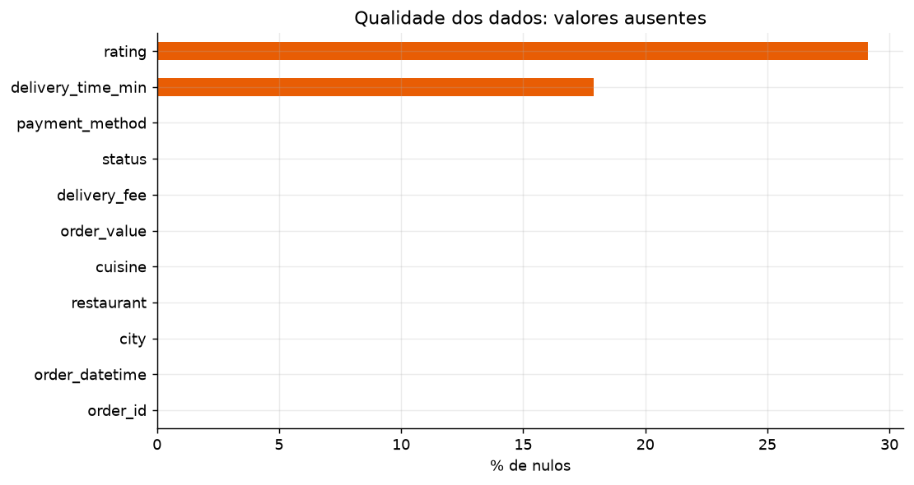
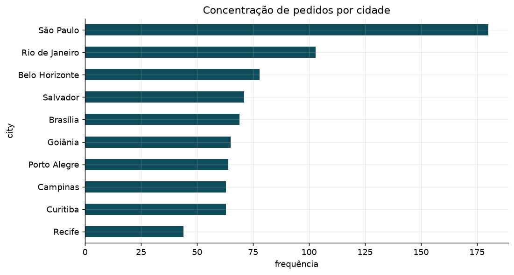
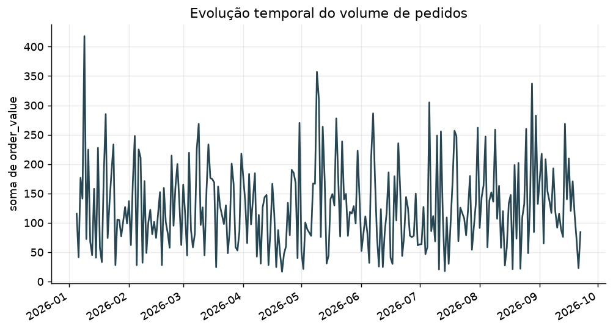
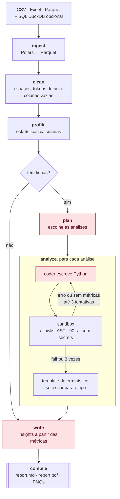

# Agente de automação de relatórios

Analistas de Operações gastam horas montando relatórios recorrentes: limpar a base, calcular os mesmos recortes, montar os gráficos e escrever o resumo para a gestão. Este agente faz esse trabalho em minutos. Ele recebe uma tabela (CSV, Excel, Parquet ou uma consulta SQL no DuckDB), limpa, analisa e devolve um relatório em Markdown e PDF com gráficos e insights, e **mede quanto tempo economizou** em relação ao processo manual.

**App publicado:** <https://agente-automacao-relatorios.streamlit.app/>

A limpeza, o perfil e as métricas saem de código executado. O modelo escolhe o que analisar, escreve o Python que roda num sandbox e redige o texto a partir dessas métricas. O prompt proíbe números novos, e um avaliador mede quantos escapam: na última medição, 2,9% dos números do texto não estavam nos dados.

## Tempo manual estimado vs Tempo do agente

O dataset de exemplo `pedidos_delivery.csv` (800 linhas, 11 colunas) é sintético. A comparação usa uma estimativa de 1h45 de trabalho manual (EDA, gráficos e texto), o meio da faixa de 1h30–2h de quem já faz o relatório de cor. Como medir o tempo manual de verdade está em [`results.md`](results.md#como-cronometrar-o-tempo-manual).

| | Sem LLM | Com LLM |
|---|---|---|
| Tempo do agente | **0,8 s** | **2 min 7 s** |
| Redução de tempo | 99,99% | **97,98%** |
| Custo | $0 | **$0** (13 473 tokens, 8 chamadas, modelo gratuito) |
| Análises | templates prontos | 5 de 5 com código gerado pelo LLM |

Corrida única de 2026-11-08, com `pedidos_delivery.csv`. O tempo do agente é medido com `time.perf_counter()` em cada etapa e sai no próprio relatório; a redução usa a estimativa de 1h45 no denominador. A média de várias corridas está na tabela abaixo.

### Qualidade dos prompts

Os prompts foram reescritos e medidos com [`scripts/eval_prompts.py`](scripts/eval_prompts.py), em 4 corridas por versão, 2 com pedidos e 2 com chamados de suporte:

| | v1 | v2 |
|---|---|---|
| Análises resolvidas por código gerado | 84% | **100%** |
| Código certo na 1ª tentativa | 58% | **95%** |
| Números no texto que não vieram dos dados | 6,1% | **2,9%** |
| Tempo médio por relatório | 3 min 43 s | **2 min 50 s** |

A v1 corresponde a `outputs/eval/baseline.json` e a v2 a `outputs/eval/v2.json`, ambos fora do git. Detalhes, metodologia e limitações em [`results.md`](results.md). Alguns ajustes feitos depois da v2 ainda não passaram por essa medição.

## Demo

| Nulos por coluna | Pedidos por cidade | Série temporal |
|---|---|---|
|  |  |  |

## Como funciona



As etapas em rosa usam o LLM. Sem chave de API, ou com `--no-llm`, cada uma tem uma versão determinística: o plano sai do perfil, as análises usam templates e o texto é montado a partir das métricas.

| Etapa | O que faz | Código |
|---|---|---|
| ingest | Lê o arquivo, aplica o SQL opcional e salva em Parquet | [`tools/data_loader.py`](tools/data_loader.py) |
| clean | Limpeza leve e registrada, sem apagar linhas nem imputar nulos | [`tools/cleaner.py`](tools/cleaner.py) |
| profile | Tipos, nulos, cardinalidade, exemplos e resumo numérico | [`tools/profiler.py`](tools/profiler.py) |
| plan | O LLM escolhe as análises a partir do perfil (o prompt pede de 3 a 5; o plano determinístico tem no máximo 5) | [`prompts/planner.md`](prompts/planner.md) |
| analyze | O LLM gera Python, que roda no sandbox e imprime as métricas | [`prompts/coder.md`](prompts/coder.md), [`tools/code_executor.py`](tools/code_executor.py) |
| write | O LLM escreve Insights, Recomendações e Limitações | [`prompts/writer.md`](prompts/writer.md) |
| compile | Monta o Markdown e o PDF com tempos, limpeza e tokens | [`tools/report_builder.py`](tools/report_builder.py) |

A orquestração é um grafo LangGraph com estado tipado ([`graph/state.py`](graph/state.py)) e uma aresta condicional para datasets sem linhas ([`graph/workflow.py`](graph/workflow.py)).

## Rodando localmente

```bash
python -m venv .venv
# Windows: .venv\Scripts\activate    Linux/macOS: source .venv/bin/activate
pip install -r requirements.txt

python cli.py sample                                       # gera data/raw/pedidos_delivery.csv
python cli.py run data/raw/pedidos_delivery.csv --no-llm   # sem LLM, em menos de 1 s
streamlit run app.py                                    # interface web
```

Cada execução cria `outputs/reports/<data>_<hora>_<id>/`, com `report.md`, `report.pdf` e os gráficos em `plots/`.

Outras opções da CLI (`python cli.py run --help`):

```bash
# Filtra com SQL antes de analisar (a tabela se chama source)
python cli.py run data/raw/pedidos_delivery.csv --sql "SELECT * FROM source WHERE status = 'delivered'"

# Usa o LLM para planejar e escrever, mas analisa com templates
python cli.py run data/raw/pedidos_delivery.csv --no-codegen

# Muda a estimativa de tempo manual usada na comparação (padrão: 105 min)
python cli.py run data/raw/pedidos_delivery.csv --manual-minutes 120

# Salva em outra pasta (padrão: outputs/reports)
python cli.py run data/raw/pedidos_delivery.csv --out relatorios/

# Consulta um banco DuckDB (o --sql é obrigatório nesse caso)
python cli.py run vendas.duckdb --sql "SELECT * FROM pedidos"   # .duckdb ou .db

# Gera um dataset de exemplo de outro tamanho
python cli.py sample --n 2000 --seed 7 --dest data/raw/pedidos_2000.csv
```

### Configurando o LLM

Copie `.env.example` para `.env` e preencha uma chave. As chamadas passam pelo [LiteLLM](https://docs.litellm.ai/docs/providers), mas o pipeline só considera o LLM configurado com uma destas cinco chaves. `LLM_MODEL` precisa ser do mesmo provedor da chave preenchida:

| Provedor | Variável | `LLM_MODEL` |
|---|---|---|
| OpenRouter (padrão, gratuito) | `OPENROUTER_API_KEY` | `openrouter/nvidia/nemotron-3-ultra-550b-a55b:free` |
| OpenAI | `OPENAI_API_KEY` | `openai/<modelo>` |
| Google Gemini | `GEMINI_API_KEY` | `gemini/<modelo>` |
| Groq | `GROQ_API_KEY` | `groq/<modelo>` |
| Anthropic | `ANTHROPIC_API_KEY` | `anthropic/<modelo>` |

Com `OPENROUTER_API_KEY` definida, um `LLM_MODEL` sem prefixo de provedor (por exemplo `nvidia/nemotron-...`) ganha `openrouter/` na frente. Não há checagem prévia de que o modelo combina com a chave: se a chamada falha, a etapa volta para o modo determinístico e o log mostra o erro.

O plano gratuito do OpenRouter tem um limite diário de chamadas. Quando ele estoura, o pipeline não para: cada etapa volta para a versão determinística e o log mostra o motivo.

## App no Streamlit Cloud

O app publicado roda o mesmo pipeline, com algumas diferenças pensadas para um link público:

- **Código gerado não roda no app.** Mesmo com o LLM ligado, ele só planeja e escreve, e as análises usam templates. O codegen no sandbox fica na CLI local.
- **Erro de SQL aparece como mensagem**, não como traceback. A trava do SQL vale também na CLI: só uma instrução `SELECT` ou `WITH` sobre a tabela `source`, e, antes de rodar a consulta, o acesso do DuckDB a arquivos é desligado e travado, então funções como `read_text` não leem nada do servidor.
- **Upload de até 20 MB**, com nome sanitizado. Arquivos enviados e relatórios com mais de 6 horas são apagados a cada nova execução.
- Se o LLM for ligado sem chave configurada, o app avisa e segue no modo determinístico.

Para publicar o seu: em [share.streamlit.io](https://share.streamlit.io), crie um app apontando para este repositório, branch `main`, arquivo `app.py`. O `runtime.txt` pede Python 3.12.

Para usar o LLM no app, coloque a chave em **Settings → Secrets**, na raiz do TOML. O Streamlit exporta as chaves da raiz como variáveis de ambiente, que é de onde o código lê. Dentro de uma seção como `[openrouter]`, ela não é encontrada:

```toml
OPENROUTER_API_KEY = "sk-or-..."
```

Num app público, qualquer visitante pode ligar o LLM e consumir essa cota. Por isso a recomendação é deixar o app público sem chave.

## Segurança do sandbox

O código gerado pelo LLM só roda na CLI e passa por duas barreiras ([`tools/code_executor.py`](tools/code_executor.py)):

1. **Análise da AST** antes de rodar. O código é rejeitado se importar algo fora de pandas, numpy, matplotlib e alguns módulos da biblioteca padrão, se usar `open`, `eval`, `exec`, `getattr` ou similares, se citar `os`, `sys`, `subprocess`, `socket` e afins, se acessar atributos `__dunder__`, ou se chamar funções que leem ou gravam arquivos, como `pd.read_csv`, `df.to_csv` e `np.load`.
2. **Subprocesso separado**, com timeout de 90 s, diretório de trabalho na pasta `plots/` do relatório e um ambiente mínimo, sem nenhuma variável `*_API_KEY`.

Não é isolamento de sistema operacional, como um container. Os imports passam por uma allowlist, mas nomes, atributos e funções de arquivo são uma lista de bloqueio: isso reduz bastante o risco, mas não garante que nenhum caminho escape. Por isso o codegen fica desligado no app público.

## Avaliando os prompts

```bash
python scripts/eval_prompts.py --label minha_versao --runs 2 --compare outputs/eval/v2.json
```

O script roda o pipeline completo com LLM em dois datasets e mede:

- **Planner:** colunas inexistentes, colunas de ID e análises repetidas.
- **Coder:** sucesso, sucesso na 1ª tentativa e quedas para o template.
- **Writer:** números no texto que não aparecem nos dados que ele recebeu.

O resultado fica em `outputs/eval/<label>.json`, fora do git. Num clone novo, rode primeiro uma versão de referência e compare com ela; os números das versões anteriores estão em [`results.md`](results.md).

## Estrutura

```text
agente-automacao-relatorios/
├── app.py                # Interface Streamlit
├── cli.py                # CLI (Typer): sample e run
├── graph/                # LangGraph: estado, nós e o grafo
├── tools/                # Código determinístico: loader, cleaner, profiler,
│                         #   analyses (templates), code_executor (sandbox),
│                         #   report_builder (Markdown e PDF), models (Pydantic),
│                         #   llm, timing, progress, uploads, sample_data
├── prompts/              # Prompts do planner, coder e writer
├── scripts/              # eval_prompts.py
├── experiments/          # Histórico das versões do pipeline
├── tests/                # pytest, incluindo testes do app com AppTest
├── data/raw/             # Dataset de exemplo
├── data/processed/       # Uploads do app (apagados após 6 h, fora do git)
├── docs/demo/            # Gráficos usados neste README
├── .streamlit/           # Configuração do app (limite de upload)
├── results.md            # Medições de tempo e de qualidade dos prompts
├── requirements.txt      # Dependências
├── runtime.txt           # Versão do Python no Streamlit Cloud
├── .env.example          # Modelo do .env com as chaves de LLM
└── outputs/              # Relatórios e avaliações gerados (fora do git)
```

O histórico das versões do pipeline está em [`experiments/v1_basic`](experiments/v1_basic/README.md), o MVP com análises por template e codegen só para o tipo `custom`, e em [`experiments/v2_with_cleaning`](experiments/v2_with_cleaning/README.md), que trouxe a limpeza registrada, o codegen no sandbox e a aresta condicional.

## Testes

```bash
python -m pytest
```

Os testes cobrem loader (incluindo o bloqueio de leitura de arquivos via SQL), limpeza, perfil, sandbox, uploads, medição de tempo, o pipeline sem LLM e o app Streamlit rodando com `AppTest`. Nenhum deles chama o LLM. A qualidade das respostas do modelo é medida pelo `scripts/eval_prompts.py`.

## Limitações conhecidas

- As medições de qualidade usam 4 corridas por versão com um modelo gratuito de saída variável. Servem como sinal, não como benchmark.
- O writer ainda calcula uma razão por conta própria de vez em quando, como "7 vezes maior", apesar de o prompt proibir. O avaliador detecta isso, mas o pipeline ainda não marca esses números no relatório.
- O tempo manual de 1h45 (meio da faixa de 1h30–2h, para quem já faz o relatório de cor) ainda é uma estimativa, não uma medição cronometrada. O protocolo para cronometrar está em [`results.md`](results.md#como-cronometrar-o-tempo-manual).
