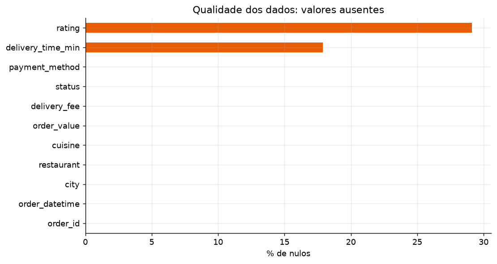
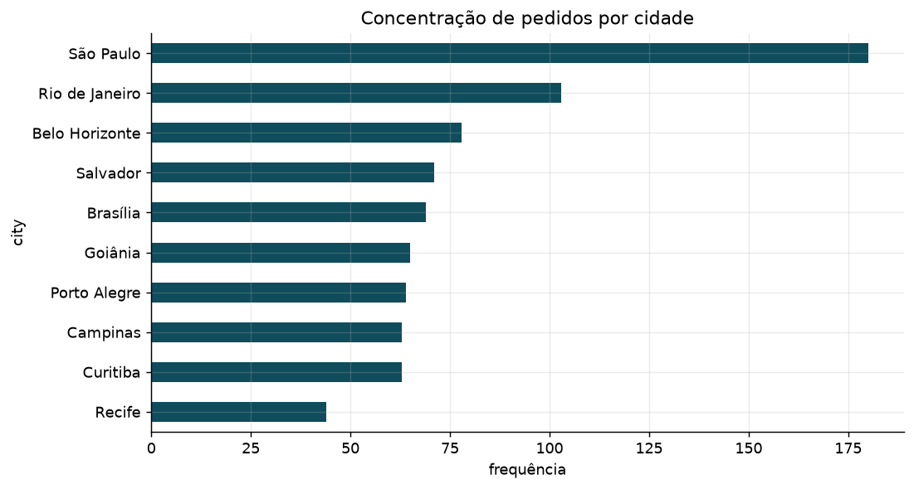
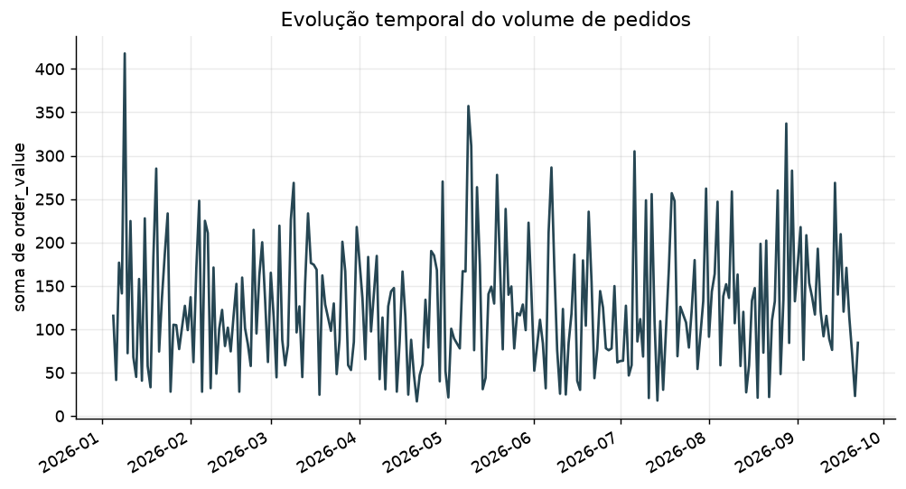

# Agente de automação de relatórios

Pipeline de **ETL leve + insights + relatório (Markdown/PDF)** para dados tabulares (CSV, Excel ou SQL DuckDB). O diferencial de portfólio — pensado para o estágio iFood — é **medir e documentar a economia de tempo** frente ao processo manual.

Não é um chatbot que “chuta” EDA. Limpeza e profiler são determinísticos; análises geram (ou reutilizam) código executado de verdade. O LLM só planeja, tenta gerar Python e narra números já calculados.

## Diferencial

| Métrica | Como medir | Sem LLM | Com LLM (OpenRouter Nemotron 3 Ultra free) |
|---|---|---|---|
| Tempo manual estimado | EDA + gráficos + relatório escrito | 3h 30min | 3h 30min |
| Tempo do agente | `time.perf_counter()` | **0.9s** | **3min 43s** |
| Redução | diferença % | 99.99% | **98.23%** |
| Custo LLM | LiteLLM | $0 | **$0** (20 904 tokens, 14 chamadas) |
| Qualidade | números batem com o código | templates + profiler | planner/writer + sandbox (3 retries) |

Detalhe: [`results.md`](results.md). Relatório gerado inclui as mesmas métricas.

## Demo







## Pipeline

```
CSV / Excel / DuckDB
        ↓
   ingestão (Polars + Parquet)
        ↓
   limpeza leve (strip, tokens nulos, colunas vazias)
        ↓
   profiler factual
        ↓
   planner (3–5 análises)
        ↓
   codegen no sandbox (3 retries) → fallback template
        ↓
   writer (insights)
        ↓
   Markdown + PDF  (+ tempos, limpeza, tokens)
```

Orquestração: **LangGraph**. Estado tipado, um nó por etapa.

## Stack

Python 3.11+ · LangGraph · Polars · DuckDB · Pydantic v2 · LiteLLM · Matplotlib/Plotly · ReportLab · Streamlit · Typer · pytest

PDF via ReportLab (funciona no Windows; WeasyPrint exigiria GTK).

## Quickstart

```bash
python -m venv .venv
# Windows: .venv\Scripts\activate
pip install -r requirements.txt

python cli.py sample
python cli.py run data/raw/pedidos_ifood.csv --no-llm
streamlit run app.py
```

LLM (OpenRouter). Copie `.env.example` → `.env` e preencha `OPENROUTER_API_KEY`. Modelo padrão:

`openrouter/nvidia/nemotron-3-ultra-550b-a55b:free`

```bash
python cli.py run data/raw/pedidos_ifood.csv
```

SQL opcional (tabela `source`):

```bash
python cli.py run data/raw/pedidos_ifood.csv --sql "SELECT * FROM source WHERE status = 'delivered'"
```

Sem chave, planner/writer/codegen caem no modo determinístico.

## Streamlit Community Cloud

O `app.py` já está na raiz e há um `runtime.txt` com **Python 3.12**. Em [share.streamlit.io](https://share.streamlit.io): New app → este repo → `app.py`. Secrets opcionais: `OPENROUTER_API_KEY`, `LLM_MODEL`.

## O que o agente faz / não faz

Faz: limpeza registrada, perfil real, plano data-agnostic, gráficos a partir dos dados, sandbox com timeout, seção de economia de tempo.

Não faz: inventar estatística, imputar nulos, apagar linhas, hardcodar nomes de coluna, seguir depois de erro silencioso.

## Testes

```bash
pytest
```
